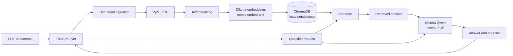

# Local PDF RAG Assistant

A local question-answering API for PDF documents. The application extracts text from uploaded PDFs, splits it into overlapping chunks, stores embeddings in a persistent ChromaDB collection, retrieves relevant passages for a question, and asks a local Ollama language model to answer from that context. FastAPI exposes the question-answering and document-management operations.

## Problem statement

Finding a precise answer in a collection of PDFs can require manual searching. This project demonstrates a local Retrieval-Augmented Generation (RAG) flow that retrieves document passages before generating an answer, with source filenames and page numbers returned separately.

## Key features

- Extracts page text from PDFs with PyMuPDF.
- Splits text into sentence-oriented chunks with configurable size and overlap.
- Generates document and query embeddings with Ollama's `nomic-embed-text` model.
- Persists vectors and chunk metadata in a local ChromaDB collection named `company_policies`.
- Retrieves relevant chunks and generates context-grounded answers with `qwen2.5:3b`.
- Supports conversational follow-up query rewriting using recent chat history.
- Exposes PDF upload, listing, deletion, health, and question-answering endpoints through FastAPI.
- Includes small retrieval and answer evaluation datasets and scripts.

## Architecture overview



FastAPI is the HTTP interface around the existing ingestion and RAG modules. The upload endpoint calls the PDF-to-Chroma ingestion function; the ask endpoint invokes the RAG pipeline. ChromaDB files live in `./chroma_db` and are created/populated when PDFs are ingested. The database is local runtime state and is not committed.

## Technology stack

- Python
- FastAPI and Uvicorn
- PyMuPDF (`pymupdf`) for PDF text extraction
- Ollama Python client and local Ollama service
- `nomic-embed-text` for embeddings
- `qwen2.5:3b` for generation and follow-up question rewriting
- ChromaDB for local vector persistence

## How RAG works in this project

1. A PDF is uploaded through the API or placed in `data/` for the ingestion script.
2. PyMuPDF extracts non-empty page text and retains its source filename and page number.
3. `text_chunker.py` normalizes whitespace and splits text around sentence boundaries (default target: 800 characters, with 150-character overlap).
4. `embedding_generator.py` calls Ollama with `nomic-embed-text`; the document embedding input is prefixed with `search_document:`.
5. `vector_store.py` upserts each chunk, its embedding, and source/page/chunk metadata into the persistent `company_policies` ChromaDB collection using cosine distance.
6. For a question, the pipeline optionally rewrites a follow-up using recent chat history, embeds the search query with the `search_query:` prefix, and retrieves the top two chunks.
7. The retrieved context and original question are sent to `qwen2.5:3b`. The prompt instructs the model to answer only from context and to say when the documents do not contain the answer.
8. The API returns the answer, unique source/page references, and rewritten search query when available.

## Project directory structure

```text
rag-pdf-assistant/
├── answer_evaluation_dataset.py  # Small answer evaluation cases
├── answer_evaluator.py           # Answer evaluation runner
├── data/
│   └── .gitkeep                  # Keeps the empty local-PDF directory in Git
├── document_manager.py           # Interactive local document manager
├── embedding_generator.py        # Ollama embedding generation
├── evaluation_dataset.py         # Small retrieval evaluation cases
├── main.py                       # FastAPI application and endpoints
├── pdf_processor.py              # PDF text extraction
├── rag_pipeline.py               # Query rewrite and answer generation
├── retriever.py                  # ChromaDB retrieval
├── retrieval_evaluator.py        # Retrieval evaluation runner
├── text_chunker.py               # Text chunking
├── vector_store.py               # PDF ingestion and ChromaDB persistence
├── .gitignore
├── README.md
└── requirements.txt
```

The local `data/*.pdf` files and `chroma_db/` are intentionally excluded from Git. Add only documents you own or have permission to distribute. `config.py` is currently empty and unused; it is omitted from the documented runtime structure.

## Prerequisites

- Windows 10/11 with PowerShell
- Python 3.10 or newer
- Ollama installed and running locally
- Enough memory and disk space for the selected local models

## Local installation (Windows PowerShell)

Open PowerShell in the repository directory:

```powershell
cd C:\path\to\rag-pdf-assistant
py -3 -m venv .venv
.\.venv\Scripts\Activate.ps1
python -m pip install --upgrade pip
pip install -r requirements.txt
```

If PowerShell blocks activation in the current session, use `Set-ExecutionPolicy -Scope Process -ExecutionPolicy Bypass`, then activate again.

## Ollama installation and model setup

Install Ollama for Windows from [ollama.com/download](https://ollama.com/download), start the Ollama application/service, then pull both models in PowerShell:

```powershell
ollama pull qwen2.5:3b
ollama pull nomic-embed-text
ollama list
```

The model names are defined in `rag_pipeline.py` and `embedding_generator.py`/`retriever.py`. The Ollama service must be available while ingesting documents, evaluating, or answering questions.

## Environment setup

No `.env` file or API key is required by the current code. Runtime data is relative to the current working directory: PDFs go in `data/`, and ChromaDB is stored in `chroma_db/`. Start commands from the project root so those paths resolve as expected.

Before starting the API, create the collection and ingest at least one PDF. Put authorized PDFs under `data/`, then run:

```powershell
python vector_store.py
```

The script indexes each `*.pdf` in `data/`. The API's current module initialization opens the `company_policies` collection when `main.py` loads, so starting it before the first ingestion will fail if the local ChromaDB collection does not exist.

## Running the application

With the virtual environment active, Ollama running, and at least one PDF ingested:

```powershell
uvicorn main:app --reload
```

The API listens at `http://127.0.0.1:8000` by default. Stop it with `Ctrl+C`.

## API endpoints

| Method | Path | Behavior |
|---|---|---|
| `GET` | `/` | Returns a welcome message and running status. |
| `GET` | `/health` | Returns the service health status. |
| `POST` | `/ask` | Generates an answer from retrieved context and returns source references and the search query. |
| `POST` | `/documents/upload` | Accepts a multipart PDF, saves it under `data/`, and indexes its chunks. |
| `GET` | `/documents` | Lists unique indexed filenames and chunk counts. |
| `DELETE` | `/documents/{filename}` | Deletes the indexed chunks and, if present, the matching PDF under `data/`. |

`/ask` accepts a question from 3 to 1000 characters and an optional `chat_history` list of message dictionaries. `sources` contains unique `{ "source", "page" }` objects. If the pipeline returns no answerable context, sources are empty; the current implementation's `search_query` is then `null`.

## Example API requests and responses

Ask a question:

```powershell
curl.exe -X POST "http://127.0.0.1:8000/ask" `
  -H "Content-Type: application/json" `
  -d '{"question":"How many annual leave days do employees receive?","chat_history":[]}'
```

Example response (answer text and source depend on the ingested PDFs and model output):

```json
{
  "question": "How many annual leave days do employees receive?",
  "answer": "The answer generated from the retrieved document context.",
  "sources": [
    { "source": "employee_handbook.pdf", "page": 4 }
  ],
  "search_query": "How many annual leave days do employees receive?"
}
```

Upload a PDF:

```powershell
curl.exe -X POST "http://127.0.0.1:8000/documents/upload" `
  -F "file=@C:\path\to\your-document.pdf"
```

List indexed documents:

```powershell
curl.exe "http://127.0.0.1:8000/documents"
```

Delete by filename:

```powershell
curl.exe -X DELETE "http://127.0.0.1:8000/documents/your-document.pdf"
```

## Swagger documentation

When the server is running, open [http://127.0.0.1:8000/docs](http://127.0.0.1:8000/docs) for interactive Swagger UI, or [http://127.0.0.1:8000/openapi.json](http://127.0.0.1:8000/openapi.json) for the generated OpenAPI schema.

## Document ingestion and management

For batch ingestion, put PDFs in `data/` and run `python vector_store.py`. For API ingestion, use `POST /documents/upload`; it writes the file to `data/` and indexes it immediately. Use `GET /documents` to list indexed names and chunk totals, and `DELETE /documents/{filename}` to remove one indexed document. `document_manager.py` also provides an interactive local add/list/delete menu (`python document_manager.py`); deletion through this CLI removes database records but does not remove the original PDF file.

The collection stores extracted chunks and metadata locally in `chroma_db/`. Back up or remove this directory as local data; it is generated state and should not be pushed to GitHub. PDFs in `data/` are local inputs and are ignored by Git by default.

## Retrieval evaluation

Run the existing keyword-based retrieval checks after indexing the expected evaluation documents:

```powershell
python retrieval_evaluator.py
```

The reported local result is **10/10 test cases passed**. Each case checks whether the expected filename appears among the top three results and whether all listed expected terms appear in retrieved text. This is a small keyword-based dataset, not a measure of general retrieval quality or production accuracy. The dataset expects `employee_handbook.pdf`, `it_security_policy.pdf`, and `travel_expense_policy.pdf`; add suitable documents locally before running it.

## Answer evaluation

Run the existing answer checks after indexing the corresponding local documents and ensuring the Ollama models are available:

```powershell
python answer_evaluator.py
```

The reported local result is **5/5 test cases passed**. Four checks look for expected literal terms in generated answers, and one checks for a refusal phrase. This is a small keyword-based dataset; it does not establish factual correctness, citation quality, robustness, or production-level accuracy. Results may vary with model versions and document content.

## Current limitations

- The evaluation datasets are small, manually specified, and keyword-based.
- PDF extraction is text-oriented; scanned PDFs may require OCR, which is not implemented.
- Retrieval uses a fixed top-k and does not expose configurable ranking or confidence thresholds.
- There is no authentication, authorization, rate limiting, or multi-user isolation.
- The API expects a pre-existing ChromaDB collection at startup; ingest documents before starting a fresh installation.
- Paths are relative to the process working directory, so run commands from the project root.
- Upload size/type handling is basic and does not inspect PDF content beyond the filename suffix.
- The answer generation relies on a local model and retrieved context; outputs should be reviewed for consequential use.

## Future improvements

- Expand evaluation data and add semantic/human review metrics.
- Add OCR for scanned documents and more robust PDF validation.
- Make model, database path, and retrieval settings configurable.
- Improve upload error handling and operational logging.
- Add automated tests for API behavior, ingestion, and retrieval edge cases.
- Add authentication and access controls before exposing the API beyond a trusted local environment.

## License

No license is currently included. Choose and add a license before publishing if you want to grant reuse rights. MIT is a common permissive option for a portfolio project; select it explicitly and include its standard license text, or choose another license that fits your intent.
